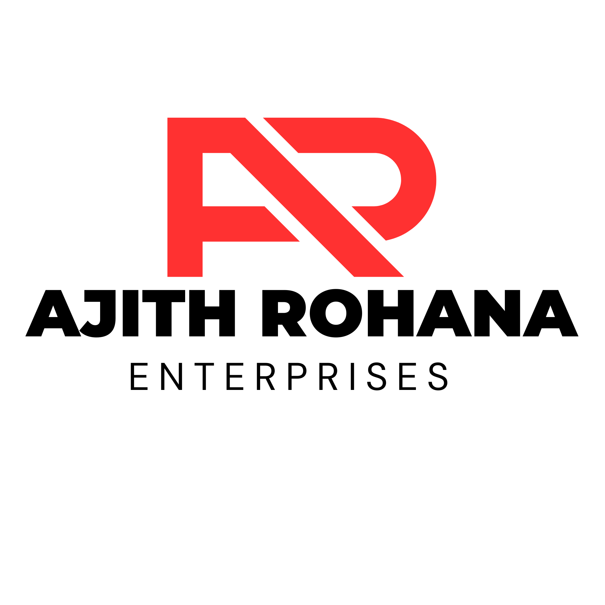

<div align="center">



# 🎟️ Lottery Manager

### Ajith Rohana Enterprise · Lottery Distribution & Business Management

**An offline-first desktop management system for Sri Lankan lottery distribution operations.**

[](src-tauri/tauri.conf.json)


**[Overview](#-overview) · [Features](#-features) · [Architecture](#-architecture) · [Getting started](#-getting-started) · [Settings](#-settings--administration) · [Safety](#-data-safety--security)**

<sub>Desktop product: <strong>Ajith Rohana Enterprise — Lottery Manager</strong> · Powered by Asroz</sub>

</div>

---

## ✨ Overview

Lottery Manager is a **Tauri 2 + React + TypeScript** desktop application built to organize day-to-day ticket purchasing, inventory, agent distribution, sales invoicing, collections, expenses, and reporting for a lottery distribution business. The application keeps its **authoritative business records locally in SQLite** and can optionally synchronize supported records to a Go API backed by PostgreSQL.

It is designed around **NLB (National Lotteries Board)** and **DLB (Development Lotteries Board)** ticket workflows. Many operating screens remain available without a permanent internet connection; cloud-dependent actions and updates still require network access.

> **Project status:** This README describes modules and configuration paths present in the source tree at version **1.0.35**. Their presence is not a claim that every workflow has passed end-to-end testing or is production-ready.

## 🧩 Features

| Area | Available application screens and workflows |
|---|---|
| **Overview** | Business dashboard, activity summaries and alerts |
| **Purchasing** | Supplier purchase invoices, stock intake and settlement |
| **Inventory** | Lottery-game catalog, ticket batches, barcode ranges and stock visibility |
| **Sales** | New invoices, drafts, confirmed/paid/cancelled invoices and invoice template management |
| **Collections** | Daily collections, commission tracking and petty cash |
| **Agents** | Sub-agent profiles, account-related information and distribution summaries |
| **Analytics** | Operational reports, profit analytics and AI-assisted analysis interface |
| **Operations** | Payroll, supplier returns, printing and export tools |
| **Administration** | Company profile, invoice defaults, lottery games, PIN access, backups, AI/API configuration, updates and CSV import |

### Typical business flow

```text
Supplier purchase
       │
       ▼
Ticket stock / inventory
       │
       ▼
Distribution to sub-agents
       │
       ▼
Invoice → collection / payment
       │
       ├── Returns / adjustments
       └── Reports / profit analytics
```

Some processes span multiple screens. Refer to the implementation and test with non-production data before relying on financial totals.

## 🏗️ Architecture

```text
┌────────────────────────────────────────────┐
│ Desktop app — Tauri 2                      │
│ React 19 · TypeScript · Vite · Tailwind CSS │
│ Dashboard / forms / reports / settings     │
└──────────────────┬─────────────────────────┘
                   │ Tauri commands + SQL plugin
                   ▼
┌────────────────────────────────────────────┐
│ Local SQLite database                      │
│ Primary / authoritative business records   │
└──────────────────┬─────────────────────────┘
                   │ Optional asynchronous sync
                   ▼
┌────────────────────────────────────────────┐
│ Go HTTP API (api-server/)                  │
│ Device authentication · sync endpoints     │
└──────────────────┬─────────────────────────┘
                   ▼
┌────────────────────────────────────────────┐
│ PostgreSQL                                 │
│ Remote replica / sync destination           │
└────────────────────────────────────────────┘
```

| Layer | Technology | Role |
|---|---|---|
| Desktop shell | Tauri 2 / Rust | Native window, filesystem integration, backup/restore and native commands |
| Interface | React 19 / TypeScript | Business screens and client-side logic |
| Frontend tooling | Vite 7 / Tailwind CSS 4 / Bun | Development and frontend compilation |
| Local persistence | SQLite via Tauri SQL plugin | Primary local business data |
| Optional synchronization | Go + PostgreSQL | Remote API and replicated records |
| Optional cloud integration | Supabase client | Integration code retained in the project |
| Charts / documents | Recharts / html2pdf.js | Visual reports and PDF-oriented export |

**Important:** PostgreSQL and Supabase should not be treated as complete replacements for the local SQLite database. Not every local settings or business table is necessarily replicated. See [BACKUP.md](BACKUP.md).

## 🚀 Getting started

### Prerequisites

- **Bun** for JavaScript dependency management and development commands.
- **Rust toolchain** for the native Tauri application.
- **Tauri 2 platform prerequisites**, including WebView2 tooling on Windows or WebKitGTK development libraries on Linux.
- For optional API work: **Go** and a reachable **PostgreSQL** instance.

See the [official Tauri prerequisites guide](https://v2.tauri.app/start/prerequisites/) for platform-specific requirements.

### Run locally in development

From the repository root:

```bash
git clone https://github.com/Victor-dev-03-cmd/lottery-software.git
cd lottery-software

bun install
bun run tauri dev
```

The Tauri dev command starts the native application and runs the configured Vite frontend dev server.

### Frontend-only development

```bash
bun run dev
```

The Vite preview is useful for frontend development, but **native Tauri APIs and local database behavior cannot be fully verified in an ordinary browser tab**.

### Static frontend check

```bash
bun run build
```

This runs TypeScript compilation and Vite bundling, **not** a Windows/Linux installer build. No build or release was initiated as part of this README update.

> Keep business databases, API keys and production configuration out of source control. Work with test data when evaluating changes.

## 🖥️ First-run setup

On initial desktop launch, the application includes a setup wizard for configuring its local database location. The local database path is resolved through the native Tauri layer, respecting the configured directory.

After opening the application, review the **Settings** page before using live business records:

1. Enter company details and invoice preferences.
2. Check the NLB/DLB game catalog and pricing.
3. Configure role PINs and create a verified backup.
4. Configure remote synchronization and AI integration **only when needed**.
5. Confirm printing/export layout and test representative transactions.

The current UI provides **English and Sinhala** translation support. Some content may remain untranslated; Tamil is not advertised here as a complete interface language.

## ⚙️ Settings & administration

The Settings page contains six main tabs:

| Tab | Purpose |
|---|---|
| **General** | Company name, contact details, invoice numbering prefix, automatic/manual invoice numbering and default preparer |
| **Games** | Add/edit/enable/disable lottery games and manage purchase/sale price values |
| **Backup & Security** | Admin/cashier PINs, backup options, manual SQLite backup/restore, protected factory reset and Go API connection |
| **AI Configuration** | Enter an optional Gemini API key and test AI connectivity |
| **Software Updates** | Check for available releases and supported update/download paths |
| **Import Data** | CSV import with downloadable templates for agents, games, inventory and purchases |

**Administrative caution:** Factory reset and database restore can change or permanently remove local data. Read prompts carefully and verify an independent backup first. PIN protection is a convenience/access-control layer; it is not a substitute for full-disk encryption, operating-system account security or secured backend authentication.

## 📥 CSV import

The Import Data tab offers templates for four categories:

- Agent profiles
- NLB/DLB lottery games
- Inventory batches
- Purchase history

Export a spreadsheet to **CSV** before uploading. The importer previews row-level validation results; use a backup and a small test batch first. See [`src/components/ImportDataTab.tsx`](src/components/ImportDataTab.tsx) for accepted columns and implementation details.

## 🌐 Optional Go API & PostgreSQL sync

The API code lives in [`api-server/`](api-server/), separate from the desktop frontend. It includes authenticated sync handlers, database migrations, result endpoints, and API tests. This is **optional**; local SQLite remains the primary system of record.

To configure an API environment:

```bash
cd api-server
cp .env.example .env
```

Edit `.env` to provide `DATABASE_URL`, a strong `JWT_SECRET`, and any required bootstrap configuration. Then, after provisioning PostgreSQL, a developer can start the API with:

```bash
go run .
```

The example configuration uses port `8090`. The API exposes a health endpoint at `GET /api/v1/health`. Initial device registration uses a bootstrap flow; do not publish bootstrap tokens or device keys. Configure the desktop API URL and device key in the **Backup & Security → Go API Backend** section.

> Do not expose an unprotected development API to the internet. Configure TLS, secure secrets, database credentials and host/network restrictions before any external deployment.

## 💾 Data safety & backups

The desktop **SQLite database is authoritative**. Backups should be made independently of remote synchronization, particularly before upgrades, schema changes, restore operations and factory resets.

Recommended operating practices:

- Keep a separate copy of the SQLite database outside the app-data directory.
- Verify backups using SQLite `PRAGMA integrity_check;` and sample record checks.
- Maintain a dated retention schedule and at least one off-device copy.
- Test restore procedures using a non-production copy before relying on them.
- Never commit database files, key material or `.env` secrets.

Read the operational procedure in **[BACKUP.md](BACKUP.md)**.

## 🔐 Security & release readiness

The repository includes administration PIN handling, native Rust commands, authenticated API routes and security-related checks. However, one **known high-priority release-security issue remains unresolved**:

**The Tauri updater currently has `dangerousInsecure: true` configured**, which disables cryptographic signature enforcement for updates. **Do not assume auto-updates are verified/safe for production deployment** until the documented signed-update migration is completed and tested.

References:

- [Release security and signed-update migration](RELEASE_SECURITY.md)
- [Release and updater setup](RELEASE_SETUP.md)
- [Security remediation planning notes](docs/superpowers/plans/2026-11-08-security-audit-remediation.md)

This README does not claim that an audit, complete regression test or signed production release has been completed.

## 🗂️ Repository structure

```text
lottery-software/
├── .github/workflows/     # CI, installer checks and release automation
├── api-server/            # Optional Go API and PostgreSQL synchronization
├── docs/                  # Engineering and security planning documents
├── public/                # Business branding and lottery-game images
├── scripts/               # Development/performance utilities
├── src/
│   ├── components/        # Business screens and settings panels
│   ├── contexts/          # Role/auth context
│   ├── hooks/             # PIN guard and application hooks
│   ├── i18n/              # English/Sinhala UI translations
│   ├── services/          # SQLite access and optional sync services
│   ├── utils/             # Shared calculations, barcode and helpers
│   └── App.tsx            # Main application routing and layout
├── src-tauri/
│   ├── src/               # Rust commands and desktop integration
│   └── tauri.conf.json    # Desktop identity, bundle and updater config
├── BACKUP.md              # Backup and restore operations
├── RELEASE_SECURITY.md    # Known updater-signing risk and remediation
├── RELEASE_SETUP.md       # Release configuration guidance
├── PROJECT_HISTORY.txt    # Project history notes
└── package.json           # Frontend scripts and dependencies
```

**Note:** Old generated artifacts, virtual environments, temporary promotion assets and the retired mobile-app directory are not part of the current `main` snapshot. Do not reintroduce generated data or local environments into Git.

## 🧪 Development & verification

Useful commands:

| Command | What it does |
|---|---|
| `bun run tauri dev` | Launch the native desktop development app |
| `bun run dev` | Start the frontend-only Vite server |
| `bun run build` | TypeScript check + Vite bundle |
| `cd api-server && go test ./...` | Run Go API tests |
| `cd api-server && go run .` | Start the optional API with configured environment |

A code change is **not** considered verified merely because a commit is present. For changes to data-handling screens, manually test save/reload, permissions, empty states, report totals, backup/restore and error handling using test records. Windows and Linux installation checks require separate platform-specific validation.

**Release policy:** Installer builds, tags, and releases are separate, explicitly controlled operations. Updating documentation or merging code into `main` does not itself authorize a production release.

## 🤝 Project ownership

**Product:** Ajith Rohana Enterprise — Lottery Manager  
**Software version represented here:** `1.0.35`  
**Platform:** Windows / Linux desktop project  
**Technology:** Tauri · React · TypeScript · SQLite · optional Go/PostgreSQL  
**Branding:** Powered by Asroz  
**Source:** [GitHub repository](https://github.com/Victor-dev-03-cmd/lottery-software)

This repository contains business-specific workflows and configuration. No open-source license is declared in the current root tree; do not infer permission to redistribute or reuse the software from repository visibility alone.

---

<div align="center">

**Built for practical lottery distribution operations.**

<sub>Ajith Rohana Enterprise · © 2026 · Powered by Asroz</sub>

</div>
